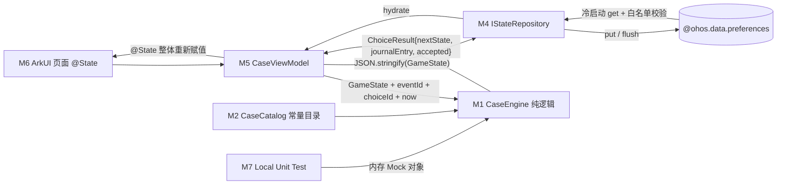

# 《雾灯档案 Foglight Files》软件需求说明书

> **文档状态**：v1.0 定稿 · 开发前完成 · 后续设计、编码、测试与报告的唯一需求输入
> **选题**：主题一 · 校园线索推理与多结局探索方向（依作业「鼓励形成自己的作品」，不沿用原题名）
> **完成方式**：独立完成，一人承担需求、设计、编码、集成、测试与交付

---

## 0. 文档说明

| 项 | 说明 |
|---|---|
| 文档用途 | 定义需求、数据契约、状态分支、模块接口、边界异常、测试与验收口径 |
| 上游依据 | 《鸿蒙高级应用开发工程师认证》期末大作业作业说明 + 评分标准 + 个人报告模板 |
| 冻结契约 | 第 3、5、7、8 章的字段名、id 枚举、事件/线索编号、结局判定优先级不得擅自改名或改语义；变更须先回写本文并同步第 9 章测试预期 |
| 不在本文范围 | 具体类实现、UI 视觉稿、目标四三份专题文档（另见 `docs/`） |
| 强约束 | ① `compatibleSdkVersion = 6.1.1(24)`、`targetSdkVersion = 26.0.0` 禁止改动；② 学习通答案须同时填写 GitHub 仓库链接与本人账号名，缺一整份作业计 0 分 |

---

## 1. 项目基本信息

| 项 | 内容 |
|---|---|
| 作品名称 | 《雾灯档案》（英文标识 `Foglight Files`） |
| 案件代号 | `CASE_2140`「钟楼第七盏灯」 |
| 选题 | 主题一 · 迷雾档案方向 |
| 一句话定位 | 一款本地单机、可存档恢复的校园推理 App：玩家以校刊见习记者身份，在 3 个场景中调查、拾取线索、作出会改变后续剧情的选择，验证推理条件后提交最终判断，进入由条件决定的不同结局 |
| 技术栈 | HarmonyOS · ArkTS + ArkUI（Stage 模型、状态管理 V1）· `@ohos.data.preferences` · `@ohos/hypium`（Local Unit Test） |
| 开发环境 | DevEco Studio 26.0.0.865（macOS ARM64）、HarmonyOS SDK API 26 / 26.0.0 Release、hvigor / ohpm |
| 版本约束 | `compatibleSdkVersion 6.1.1(24)` / `targetSdkVersion 26.0.0`（禁止改动） |
| 学号 / 姓名 / 班级 | `<学号>` / `<姓名>` / `23物联<1或2>`（待补，交付前统一替换） |
| GitHub 账号 | `3058326056-oss` |
| GitHub 仓库 | https://github.com/3058326056-oss/FoglightFiles （新建独立仓库，未使用此前任何仓库） |
| 完成方式 | **独立完成**，无组队、无分工分摊 |

**原始需求复述**：玩家调查校园谜案，需 ≥3 个可探索场景、≥12 个有意义的事件节点、≥6 条可查阅线索、≥2 个由不同条件触发的结局；线索与选择须真实改变后续事件，不能只做文字点击跳转；要有线索板、关键状态提示、阶段进度、存档与重开；完整体验为「接受调查 → 搜集线索 → 验证推理条件 → 作出最终判断 → 进入对应结局」，中途结束进程后恢复进度；运用 ArkUI 状态管理、交互与动画、业务数据建模、Preferences/RDB 与单元测试；不要求 AI 生成剧情或在线服务器；严禁把多个简单实验功能机械拼接。

---

## 2. 需求与问题分析

### 2.1 目标用户与情境

| 用户 | 情境 | 关注点 |
|---|---|---|
| 玩家（主用户，高校学生） | 晚自习后碎片时间玩一局 10–15 分钟的校园推理 | 线索找得到、选择有后果、结局讲得通、中途退出不丢进度 |
| 课程评审 / 验收者（次用户） | 在模拟器上快速核验功能与证据 | 状态变化可见、分支可复现、重启后进度一致 |
| 开发者本人 | 无真机、无网络环境下编码与自测 | 剧情引擎可脱离 `@ohos.*` 运行，Local Unit Test 可直接 import |

### 2.2 痛点与解法

| # | 痛点 | 本作品解法 |
|---|---|---|
| P1 | 多数「文字冒险」只是点击翻页，线索不影响后续 | 事件节点带线索/flag 门槛，选择写入 flag 后可**锁死或解锁**后续节点，并切换事件正文变体 |
| P2 | 分支只有结尾不同，过程无反馈 | 线索板实时标注缺失定案线索、阶段进度按线索与事件完成度推进、关键状态提示给出下一步建议 |
| P3 | 结局靠随机数或单一变量 | 结局由「指认对象 + 证据链 + 分支 flag + 时间线」四类条件按固定优先级判定，可复现、可单测 |
| P4 | 关掉 App 进度归零 | `GameState` 全量 Preferences 持久化，冷启动 `await restore()` 后渲染，恢复后可直接继续或查看已达成结局 |
| P5 | 无网络/无 AI 剧情时内容空洞 | 14 个事件、9 条线索、4 个结局全部为本地常量数据，构成一条完整案件链 |

### 2.3 产品目标与可度量判据

| 目标 | 内容 | 判据 |
|---|---|---|
| G1 **可探索** | 场景、事件、线索构成有依赖的调查网络 | 3 场景 / 14 事件 / 9 线索；至少 4 个事件因缺线索不可达，至少 2 个事件因选择结果被锁定或改正文 |
| G2 **可推导** | 推理条件可验证，结局由条件决定 | `validateHypothesis()` 返回 `ready / missingClues / errors`；4 个结局由不同条件触发且有单测锁定 |
| G3 **可延续** | 跨进程恢复且逻辑可自动验证 | 杀进程重启后线索、flag、信任度、日志、结局逐项一致；≥12 条 Local Unit Test 真实运行通过 |

### 2.4 用户故事

- U1 作为玩家，我想在三个场景间自由切换并看到「为什么这个事件现在打不开」，以便决定先去哪里。
- U2 作为玩家，我想让一次看似无关的选择（公开便签 / 替目击者保密）真的改变后面能不能拿到关键证据。
- U3 作为玩家，我想在推理台先验证证据链，再提交最终判断，而不是盲猜结局。
- U4 作为玩家，我想中途关掉 App 明天接着查，并随时能「重新开局」。
- U5 作为验收者，我想用固定输入复现两个不同结局并核对日志。

### 2.5 范围界定

**In Scope（P0 Must）**

| 功能 | 验收口径 |
|---|---|
| 案件简报与阶段进度 | 5 个阶段（BRIEFING/SEARCH/CROSSCHECK/VERDICT/ENDING）+ 百分比进度 + 下一步提示 |
| 3 个场景探索 | 场景切换、事件卡片（可用/锁定及原因）、选项交互、结果动画与 Toast |
| 14 个事件节点 | 每个节点有门槛、1–3 个选择、选择产生 effects；`completedEvents` 去重 |
| 9 条线索 + 线索板 | 卡片列出「已获得/未获得」，按场景与标签筛选，标注 3 条定案线索的缺失情况 |
| 推理验证 | 选择嫌疑人/动机/时间线，点「验证推理条件」给出 `ready / missingClues / errors` |
| 最终判断与 4 个结局 | 提交后按固定优先级判定，结局页展示分支回顾 |
| Preferences 持久化 | 全量存档、冷启动恢复、损坏回落、重开清空、日志 FIFO 上限 |
| 调查日志 | 每次有效选择追加 1 条 JournalEntry（事件、选择、获得的线索、时间） |
| 边界与异常处理 | 见第 4 章，全部可被纯逻辑单测覆盖 |
| ≥12 条自动化测试 | 正常 / 边界 / 异常三类齐备，命令行真实运行并归档结果 |

**Out of Scope**：AI 生成剧情、在线服务器与账号、多人协作、真实地图/定位、语音与视频、3D 场景、剧情分支的图编辑器、多案件包、云存档。

### 2.6 可验收标准

| 编号 | 标准 | 核验方式 |
|---|---|---|
| AC-01 | 场景 ≥3、事件节点 ≥12、线索 ≥6、结局 ≥2 | 目录常量 `SCENES / EVENTS / CLUES / ENDINGS` + 页面实际可达 |
| AC-02 | 线索与选择真实改变后续事件 | 门槛校验 + `LOCK_EVENT` / `altFlag` 变体 + T02/T03/T04 |
| AC-03 | 线索板、关键状态提示、阶段进度齐备 | 线索板页 / 简报页截图 |
| AC-04 | 完整链路可一次演示通关，且能验推理条件 | 第 6 章 8 步 + 演示录屏 |
| AC-05 | 杀进程重启后进度、日志、结局逐项恢复 | 冷启动核对 + T12 |
| AC-06 | ≥6 条自动化测试真实通过（本作品定 12 条） | `entry/src/test/` 运行结果日志与截图 |
| AC-07 | 仓库含源码、需求说明书、README、截图、演示、可核验 Commit | 第 11 章 |

---

## 3. 数据与状态分析

> 本章字段名为冻结契约，源码类型定义、JSON 键名、日志编号须与之一致。

### 3.1 关键数据实体

**E1 `Clue`（线索，9 条）**：`id: string`、`title`、`summary`、`detail`、`sceneId`、`tag`、`weight: number`、`fromEventId`。

**E2 `Scene`（场景，3 个）**：`id`、`name`、`subtitle`、`description`、`eventIds: string[]`。

**E3 `Choice`（选项）**：`id`、`text`、`hint`、`requiresClues: string[]`、`requiresFlags: string[]`、`forbiddenFlags: string[]`、`effects: Effect[]`、`resultText`。

**E4 `EventNode`（事件节点，14 个）**：`id`、`sceneId`、`title`、`body`、`altFlag`、`altBody`、`requiresClues: string[]`、`requiresFlags: string[]`、`forbiddenFlags: string[]`、`choices: Choice[]`。

**E5 `Effect`（状态变更）**：`kind: 'ADD_CLUE' | 'SET_FLAG' | 'ADJUST_TRUST' | 'LOCK_EVENT' | 'UNLOCK_EVENT'`、`key: string`、`boolValue: boolean`、`numValue: number`。所有字段均显式赋值，避免可选字段在 ArkTS 下的解析歧义。

**E6 `Hypothesis`（最终判断）**：`suspect: 'president' | 'lin' | 'zhou' | ''`、`motive: 'grade' | 'theft' | 'prank' | ''`、`timeline: '2140' | '2138' | 'unknown' | ''`。

**E7 `JournalEntry`（调查日志）**：`seq: number`（从 1 起）、`timestamp: number`、`eventId`、`choiceId`、`text`、`gainedClues: string[]`。

**E8 `GameState`（唯一权威状态 SSOT）**

| 字段 | 类型 | 说明 |
|---|---|---|
| `schemaVersion` | `number` | 当前 `1` |
| `caseId` | `string` | `'CASE_2140'` |
| `startedAt` / `updatedAt` | `number` | 时间戳 ms，由调用方注入 |
| `currentSceneId` | `string` | 当前场景 id |
| `clues` | `string[]` | 已获得线索 id，去重且顺序稳定 |
| `flags` | `Record<string, boolean>` | 分支标记，键必须在白名单内 |
| `trust` | `number` | 信任度 0–100，钳制 |
| `completedEvents` | `string[]` | 已完成事件 id，去重 |
| `lockedEvents` | `string[]` | 因选择被锁死的事件 id |
| `journal` | `JournalEntry[]` | 上限 **120** 条，FIFO |
| `hypothesis` | `Hypothesis \| null` | 最后一次提交的判断 |
| `endingId` | `string` | `''` 表示未定案，否则为 `ENDINGS` 中的 id |

**E9 `Verdict`（推理条件验证结果）**：`ready: boolean`、`errors: string[]`、`missingClues: string[]`、`matchedClues: string[]`、`hint: string`。

**E10 `Ending`（结局，4 个）**：`id`、`title`、`subtitle`、`body`、`tone`。

**E11 `Progress`（阶段进度）**：`stage: Stage`、`stageLabel: string`、`clueCount`、`totalClues`、`eventCount`、`totalEvents`、`percent: number`、`hints: string[]`。

> `Stage` = `'BRIEFING' | 'SEARCH' | 'CROSSCHECK' | 'VERDICT' | 'ENDING'`，由 `deriveStage(state)` **推导**，不单独持久化，避免存档与推导不一致。

### 3.2 状态变化

| 状态主体 | 变化 | 触发事件 | 副作用 |
|---|---|---|---|
| `clues` | 追加线索 id | 选择中的 `ADD_CLUE` | 线索板刷新、门槛重算、写盘 |
| `flags` | 置 true | `SET_FLAG` | 事件变体切换、后续节点解锁/锁定 |
| `trust` | ±N，钳到 0–100 | `ADJUST_TRUST` | 关键状态提示文案变化 |
| `lockedEvents` | 追加事件 id | `LOCK_EVENT` | 该事件永久不可达（本局） |
| `completedEvents` | 追加事件 id | 一次合法选择 | 事件从「可用」移入「已查阅」 |
| `journal` | 追加 1 条（超 120 淘汰最旧） | 一次合法选择 | 日志页刷新、写盘 |
| `endingId` | 由 `''` 变为某个结局 id | 提交最终判断 | 切换到结局页、写盘 |
| 应用生命周期 | `未恢复 → 已恢复` | `EntryAbility` 冷启动 `await restore()` | 渲染真实状态或回落新案 |

### 3.3 模块间数据流

| 流 | 方向 | 载体 | 说明 |
|---|---|---|---|
| F1 选择事件 | UI → M5 → M1 | `applyChoice(...)` | M1 不修改入参、不取时间/随机数、不落盘 |
| F2 计算结果 | M1 → M5 | `ChoiceResult` | 含新状态、日志条目、是否接受、结果文案 |
| F3 界面刷新 | M5 → UI | `@State` 新对象引用 | ArkUI V1 一级观测，整体重新赋值触发重绘 |
| F4 落盘 | M5 → M4 → Preferences | `GameState` JSON 串 | 关键路径 `await save()` 后再反馈 |
| F5 冷启动恢复 | Preferences → M4 → M5 → UI | `GameState` | 校验通过才 hydrate，失败回落并备份原串 |
| F6 测试注入 | `entry/src/test/` → M1 / M4 | 内存对象 | 不触碰系统 API |

---

## 4. 边界与异常分析（定稿 6 类）

| # | 类别 | 触发条件 | 系统表现与处理 | 对应测试 |
|---|---|---|---|---|
| EX-01 | **边界** | 事件/选择的线索或 flag 门槛未满足 | 事件卡片显示「尚缺：XX 线索 / 需先…」且不可点击；`applyChoice` 返回 `accepted=false`，状态不变；不是简单隐藏 | T02、T10 |
| EX-02 | **异常** | 非法输入：不存在的 `eventId` / `choiceId`、重复完成同一事件、对已锁定事件提交选择 | `accepted=false` + 明确 `message`，**不修改入参**、不追加日志、不写盘 | T09、T10 |
| EX-03 | **边界** | 信任度越界（初始 40，连续加分超过 100 或连续减分低于 0） | `ADJUST_TRUST` 统一 `clamp(v,0,100)`，返回状态始终 0–100 | T08 |
| EX-04 | **异常** | 存档损坏：`JSON.parse` 抛错、`schemaVersion` 不符、字段缺失、`clues/events/flags` 出现目录外 id、`trust` 为 `NaN` | 原串写入 `game_state_backup`，回落 `createNewCase(now)`，Toast「存档异常，已重新开局」，先落盘再渲染；加载期间显示加载态 | T11 |
| EX-05 | **边界** | 推理条件不足仍提交判断（缺 3 条定案线索之一 / 未选完三项 / 时间线未固定） | `Verdict.ready=false` 并列出 `missingClues` 与 `errors`；允许提交但进入残缺结局 `END_PARTIAL`，UI 明确告知证据链缺口 | T07 |
| EX-06 | **边界** | 日志无限增长（连续操作 >120 次）、写盘过程中进程被杀、应用切后台 | `journal` 上限 120 FIFO；每次状态变更即 `await save()`；`EntryAbility.onBackground` 兜底 `flush()`；`onWindowStageCreate` 先 `await restore()` 再渲染 | T12 |

> 补充：线索漏拾（例如「略过」校庆特刊）属于**正常分支后果**，不是异常——它会让后续事件不可达并改变结局，正是本作品的核心机制。

---

## 5. 功能模块划分与接口

### 5.1 模块清单

| 模块 | 路径 | 职责 | 依赖 `@ohos.*` |
|---|---|---|---|
| M1 `CaseEngine` | `ets/engine/CaseEngine.ets` | 可用性判定、选择效果、变体正文、推理验证、结局判定、阶段推导 | **否（强制）** |
| M2 `CaseCatalog / Models` | `ets/model/Models.ets`、`CaseCatalog.ets` | 类型定义、3 场景 / 14 事件 / 9 线索 / 4 结局常量、白名单反序列化、深拷贝 | 否 |
| M3 `CaseViewModel` | `ets/viewmodel/CaseViewModel.ets` | 编排 UI 事件、持有唯一 `GameState`、串行落盘、冷启动恢复、重开 | 否（依赖注入 M4） |
| M4 `IStateRepository` | `ets/repository/` | Preferences 实现 + `InMemoryStateRepository` 测试替身 + 损坏回落 | 是（仅生产实现） |
| M5 UI 页面与组件 | `ets/pages/`、`ets/components/` | 简报 / 探索 / 线索板 / 推理 / 日志 / 结局的布局、动画与反馈 | 是（ArkUI） |
| M6 应用入口 | `ets/entryability/EntryAbility.ets` | 依赖装配、冷启动门禁、后台兜底写盘 | 是 |
| M7 本地单元测试 | `entry/src/test/` | 12 条纯逻辑用例，框架 `@ohos/hypium` | 否 |

> **本人负责内容**：M1–M7 全部模块的设计、编码、集成、测试与交付，独立完成。

### 5.2 模块间接口（冻结契约）

| 函数 | 入参 | 出参 | 说明 |
|---|---|---|---|
| `CaseEngine.availableEvents` | `state: GameState` | `EventNode[]` | 过滤已完成/已锁定/门槛不足的事件 |
| `CaseEngine.checkAvailability` | `state, event` | `Availability` | `{ available, missingClues, missingFlags, blockedBy, reason }` |
| `CaseEngine.resolveBody` | `state, event` | `string` | `altFlag` 为真时返回 `altBody` |
| `CaseEngine.applyChoice` | `state, eventId, choiceId, now, entryId` | `ChoiceResult` | 纯函数；`{ accepted, state, journalEntry, gainedClues, message, unlockedEvents }` |
| `CaseEngine.validateHypothesis` | `state, hypothesis` | `Verdict` | 校验三项选择与 3 条定案线索 + `timeline_fixed` |
| `CaseEngine.resolveEnding` | `state, hypothesis` | `Ending` | 按 7.4 优先级返回唯一结局 |
| `CaseEngine.getProgress` | `state` | `Progress` | 阶段、百分比、下一步提示 |
| `CaseEngine.deriveStage` | `state` | `Stage` | 5 阶段推导 |
| `IStateRepository.load/save/clear/readBackup` | — / `GameState` / — / — | `Promise<GameState>` / `Promise<void>` / `Promise<void>` / `Promise<string>` | 内部完成 JSON、版本与白名单校验 |
| `CaseViewModel.restore/selectScene/choose/setHypothesis/submitVerdict/restartCase` | 见源码 | `Promise<void>` / `void` | 所有写状态路径 `await save()` |

---

## 6. 核心业务流程（完整体验链路）

| 步 | 操作 | 系统行为 | 可验收反馈 |
|---|---|---|---|
| 1 | 首次冷启动 | `restore()` 无数据 → `createNewCase()` 并落盘 → 简报页 | 阶段 BRIEFING，进度 0%，提示「接受委托」 |
| 2 | 点「接受调查」 | E01 选项写入 `accepted` + 信任度，阶段转 SEARCH | 进度条动画、Toast「已进入旧馆」 |
| 3 | 旧馆依次查借阅台 / 特刊 / 便签 / 证人 | `ADD_CLUE` 累积 C1–C3，`note_kept` 等 flag 生效 | 线索板亮起 3 张卡，锁定事件显示缺线索原因 |
| 4 | **分支演示 A**：在便签处选「当场念出来」 | `exposed_note=true` + `LOCK_EVENT E09` + 信任度下降 | 目击者小周改口、E09 经费单据不可达、事件正文切换为变体 |
| 5 | 重开一局走 **分支演示 B**：替目击者保密 | `protected_witness=true` → E09 解锁 → 拿到 C5 送修回执 | 同一事件出现不同选项与结果，证明选择改变后续 |
| 6 | 连廊配电间拿到 C6/C7/C9/C8 | `timeline_fixed=true`、阶段转 CROSSCHECK → VERDICT | 关键状态提示「证据链已齐，可前往推理台」 |
| 7 | 推理台先点「验证推理条件」，再提交判断 | `Verdict.ready=true`；`resolveEnding()` 按条件返回 `END_TRUTH` | 结局页展示标题、正文、线索数/事件数/分支回顾 |
| 8 | **杀进程重启** | `await restore()` 恢复 `GameState` | 直接回到结局页，线索、flag、日志、结局与杀进程前逐项一致 |

**演示证据**：第 2/3/4/6/7/8 步各留截图；整条链路录 1 段演示视频；测试结果留日志与截图。

---

## 7. 具体设定（定稿）

### 7.1 案件与场景

校庆前夜 21:40，钟楼「星轨社」活动室断电，校庆纪念奖杯与一份评优推荐名单同时不见。玩家是校刊见习记者，受托在天亮前查清。

| `sceneId` | 名称 | 事件节点 |
|---|---|---|
| `S1` | 旧馆 · 阅览室 | E01 委托、E02 借阅台、E03 校庆特刊、E04 夹在书里的便签、E05 林学姐的证词 |
| `S2` | 钟楼 · 活动室 | E06 值班表、E07 奖杯底座、E08 目击者小周、E09 经费单据 |
| `S3` | 连廊 · 配电间 | E10 配电箱、E11 监控日志、E12 湿伞与鞋印、E13 备份名单、E14 第七盏灯 |

### 7.2 线索目录（9 条，★ 为定案线索）

| id | 名称 | 来源 | 说明 |
|---|---|---|---|
| C1 | 值日证借阅记录 | E02 | 21:05 有人借走《校史图册》 |
| C2 | 特刊上的奖杯照片 | E03 | 底座有一道旧划痕 |
| C3 | 匿名便签「21:40 别开灯」 | E04 | 字迹与社长惯用的红笔相近 |
| C4 | 被涂改的值班表 | E06 | 当晚值班人由林改为周 |
| C5 ★ | 奖杯送修回执 | E09 | 奖杯三天前已送修，**不存在失窃** |
| C6 | 配电箱手动跳闸痕迹 | E10 | 非故障，是人为拉闸 |
| C7 ★ | 监控日志断点 21:38–21:52 | E11 | 与便签时间对应 |
| C8 ★ | 备份推荐名单 | E13 | 与公示名单相差一人 |
| C9 | 湿伞与鞋印 | E12 | 水迹从活动室延伸到连廊尽头 |

### 7.3 门槛与分支（选择真实改变后续）

| 事件 | 门槛 | 分支后果（冻结） |
|---|---|---|
| E03 | `accepted` | 「略过」将永久错过 C2，导致 E07 不可达 |
| E04 | 需 `C2` | 「当场念出来」→ `exposed_note=true` + 锁定 **E09** + 信任 -10；「收进证物袋」→ `note_kept=true` |
| E05 | 需 `C1` | `exposed_note` 为真时切换 `altBody`，林学姐改口，只能得到 `witness_recanted` |
| E07 | 需 `C2` | 「比对划痕」→ `scratch_matched`；「认定失窃」→ `assumed_theft`（错误推断，但不阻断） |
| E08 | 需 `C3` | 「答应保密」→ `protected_witness`；`exposed_note` 为真时变体且证人改口 |
| E09 | 需 `C4` 且需 `protected_witness` 或 `witness_full`，且不得在 `lockedEvents` | 唯一能拿到 ★C5 的途径；公开便签的玩家**无法**取得 |
| E11 | 需 `C6` | 「导出片段」→ `timeline_fixed=true`（定案必要条件）；只记断点则无此 flag |
| E13 | 需 `C7` | 取得 ★C8 |
| E14 | 需 `C5` + `C8` + `timeline_fixed` | 还原完整时间线，`case_ready=true` |

> 该设计保证「线索与选择真实改变后续事件」：同一事件在不同 flag 下正文不同、可选项不同；错误选择会**永久关闭**一条证据链，并把玩家导向不同结局。

### 7.4 推理验证与结局判定

**定案要求**：三项选择全部非空 + 持有 `C5 / C7 / C8` + `timeline_fixed=true` → `Verdict.ready=true`。条件不足仍可提交（用于演示边界），但会得到残缺结局。

**`resolveEnding()` 固定优先级**（自上而下，命中即返回，保证唯一可复现）：

| 序 | 条件 | 结局 |
|---|---|---|
| 1 | `suspect !== 'president'` | `END_MISJUDGE`《错指的人》 |
| 2 | `exposed_note === true \|\| witness_recanted === true` | `END_COVER`《没有寄出的稿子》 |
| 3 | 定案线索齐 + `motive === 'grade'` + `timeline === '2140'` + `timeline_fixed` + `case_ready` | `END_TRUTH`《灯下的署名》 |
| 4 | 其余 | `END_PARTIAL`《半亮的路灯》 |

四个结局分别由「指认对象」「分支 flag」「完整证据链」「证据链缺口」四类不同条件触发，均可由单测精确锁定。

### 7.5 阶段推导

| 阶段 | 条件 |
|---|---|
| `BRIEFING` | `accepted !== true` |
| `SEARCH` | `clues.length < 6` |
| `CROSSCHECK` | `clues.length >= 6` 且 `timeline_fixed !== true` |
| `VERDICT` | `timeline_fixed === true` 且 `endingId === ''` |
| `ENDING` | `endingId !== ''` |

进度百分比 = `round((clues/9 × 0.6 + completedEvents/14 × 0.4) × 100)`。

---

## 8. 数据模型与持久化设计

### 8.1 选型

| 方案 | 结论 | 理由 |
|---|---|---|
| `@ohos.data.preferences` | ✅ 选用 | 单一文档型状态（1 个 `GameState`），无联表/条件查询/事务需求；键值式读写 + `flush()` 简单可靠；`IStateRepository` 接口便于单测替换为内存实现 |
| RDB | ❌ | 本作品无需关系查询，建表与版本迁移属过度设计 |
| 分布式 KV / 云 | ❌ | 超出「不要求在线服务器」范围 |

**局限与演进**：Preferences 为单文件整体读写，日志量增大后序列化占用主线程 → 本期用 120 条上限 + 关键路径异步 `await` 缓解；后续可把 `journal` 单独迁到 RDB 分页查询。

### 8.2 存储键与校验

| 项 | 值 |
|---|---|
| 实例名 | `foglight_state` |
| 主键 | `game_state` → `JSON.stringify(GameState)`（`schemaVersion: 1`） |
| 备用键 | `game_state_backup`（解析失败时的损坏原文） |
| 序列化约定 | 枚举一律字符串；时间一律 number；`flags` 用 `Record<string, boolean>`；不使用 `Map`/类实例直接序列化 |
| 白名单校验 | `caseId === 'CASE_2140'`；`schemaVersion === 1`；clue/event/scene/ending id 必须存在于目录；flag 键必须在白名单；`trust` 有限且在 0–100；`journal` 为数组且逐项字段完整；`hypothesis` 枚举值合法。**禁止直接 `as GameState` 信任解析结果** |

### 8.3 写入时机与恢复

- 写入：接受委托、每次合法选择、切换场景、保存判断、提交结局、重开案件 → 校验通过后 `await save()`；`onBackground` 兜底 `flush()`。
- 恢复：`onWindowStageCreate` 置 `isReady=false` → 加载 `Index`（只渲染加载态）→ `void bootstrap()` → `await vm.restore()` → `isReady=true` → 一次性 `syncFromModel()` 渲染真实状态。避免默认态闪现或被回写。
- 恢复验收点：线索、flag、信任度、已完成/锁定事件、日志条数与内容、判断与结局，六项与杀进程前一致。

---

## 9. 测试与验收方式

### 9.1 自动化测试清单（12 条，真实运行）

> 作业口径「每人至少 3 条、团队至少 6 条」；本作品独立完成 **12 条**，分布：正常 6 / 边界 4 / 异常 2。全部位于 `entry/src/test/`，框架 `@ohos/hypium`，Mock 输入为内存对象，不依赖设备/模拟器。

| # | 用例 | 分类 | Mock 输入 / 前置条件 | 预期结果 |
|---|---|---|---|---|
| T01 | 接受委托推进阶段 | 正常 | 新案 + E01 选项 | `accepted=true`；`deriveStage` 由 BRIEFING 变 SEARCH；日志 +1 |
| T02 | 线索门槛真实生效 | 正常 | 新案直接查 E05（需 C1）；再补 C1 后查 | 前者 `available=false` 且 `missingClues=['C1']`；后者可用 |
| T03 | 公开便签锁定证据链 | 正常 | E04 选「当场念出来」 | `exposed_note=true`、`lockedEvents` 含 E09、信任 -10；E05/E08 正文切换为 `altBody` |
| T04 | 保护证人解锁关键线索 | 正常 | E08 选「答应保密」→ E09 可达 → 选「翻到送修回执」 | `protected_witness=true`；E09 可用；获得 ★C5 |
| T05 | 完整证据链进入真相结局 | 正常 | 集齐 C5/C7/C8 + `timeline_fixed` + `case_ready` + 正确三项判断 | `Verdict.ready=true`；`resolveEnding` 返回 `END_TRUTH` |
| T06 | 指认错误进入误判结局 | 正常 | 同上但 `suspect='lin'` | 优先级 1 命中，返回 `END_MISJUDGE`（优先于 TRUTH） |
| T07 | 证据链不足的边界 | 边界 | 缺 C5 且未选完三项 | `ready=false`、`missingClues` 含 C5、`errors` 非空；提交得到 `END_PARTIAL` |
| T08 | 信任度钳制 | 边界 | 连续 +200 / -200 | 最终 `trust` 为 100 / 0，始终在 0–100 |
| T09 | 重复事件与重复线索 | 边界 | 同一事件提交两次、同一线索重复 ADD_CLUE | 第二次 `accepted=false`；`clues` 不重复；`completedEvents` 不重复；日志不重复增长 |
| T10 | 非法输入被拒绝 | 异常 | 不存在的 eventId / choiceId、门槛未满足的选项、已锁定事件 | 全部 `accepted=false`；`JSON.stringify(state)` 与入参相同（未修改） |
| T11 | 存档损坏回落 | 异常 | `'{bad json'`、`schemaVersion=999`、未知线索 id、`trust=NaN` 四种 | `sanitizeGameState` 返回 null；`InMemoryStateRepository.load()` 回落新案；`readBackup()` 可取回原文；连续两次 load 一致 |
| T12 | 冷启动恢复一致性 | 正常 | 构造含 6 条线索、3 个 flag、4 条日志、1 个结局的 `GameState` → `save()` → 新实例 `load()` | 逐字段深比较完全相等；`schemaVersion===1`；日志上限 120 FIFO 生效 |

**执行与证据**：命令行 `hvigorw test` 真实运行；保存结果日志 `docs/evidence/test/test_result.txt`、覆盖率报告与通过截图；引擎契约（id、优先级、门槛）变更后全量回归 12 条。

### 9.2 人工验收清单

| # | 验收项 |
|---|---|
| M-01 | `assembleHap` BUILD SUCCESSFUL，模拟器安装启动无崩溃 |
| M-02 | 简报页 5 阶段进度与关键状态提示随操作更新 |
| M-03 | 3 个场景可切换，事件卡片显示可用/锁定及缺失原因 |
| M-04 | 线索板 9 张卡按获得状态变化，标注 3 条定案线索 |
| M-05 | 分支 A（公开便签）与分支 B（替证人保密）产生不同事件正文与不同可达节点 |
| M-06 | 推理台可验证条件，提交后进入对应结局，结局页有分支回顾 |
| M-07 | 杀进程重启后线索/flag/日志/结局逐项一致；「重新开局」清空 |
| M-08 | 人为破坏 `game_state` 后重启，回落新案且无崩溃、Toast 提示 |
| M-09 | 12 条测试全部 PASS，截图与日志归档 |
| M-10 | 仓库含源码、需求说明书、README、架构图、≥4 张截图、演示录屏，Commit ≥8 次可核验 |
| M-11 | 学习通答案同时填写仓库链接 + `3058326056-oss` |

---

## 10. 分工（独立完成说明）

| 工作包 | 承担人 | 说明 |
|---|---|---|
| 需求分析、本文撰写、剧情与数据契约定稿 | 本人 | 独立完成，无组队、无外部代笔 |
| 架构与接口设计、纯逻辑引擎、目录常量 | 本人 | 独立设计、编码、自测 |
| Preferences 持久化、冷启动恢复、损坏回落 | 本人 | 独立完成 |
| 状态管理与 6 个页面 / 组件的交互与动画 | 本人 | 独立完成 |
| 12 条本地单元测试、运行结果与回归 | 本人 | 独立执行并留证 |
| 集成联调、构建、截图、演示、README、报告、Git 提交 | 本人 | 独立完成 |

**独立完成奖励佐证**：① 案件、分支、结局判定均自行定稿；② 纯逻辑 / Mock 目录 / 持久化 / 状态编排 / UI 五层解耦；③ 8 步链路可一次演示通关；④ 6 类边界异常有处理与测试；⑤ 12 条测试 + 截图 + 演示 + 可核验提交 + 目标四资料齐备。

---

## 11. 交付物与提交里程碑

| 类别 | 路径 |
|---|---|
| 源码 | `entry/src/main/ets/{engine,model,repository,viewmodel,pages,components,entryability}` |
| 测试 | `entry/src/test/`（12 条）+ `entry/src/ohosTest/`（模板） |
| 需求文档 | `docs/软件需求说明书.md`（本文） |
| 架构文档与图 | `docs/系统架构设计.md`、`docs/figures/fig2-1-*.svg|png`、`fig3-1-*.svg|png` |
| 目标四资料 | `docs/新技术认识.md`、`docs/学习疑问分析.md`、`docs/持续学习计划.md` |
| 项目说明 | `README.md`（功能、环境、构建运行、目录、截图与演示索引） |
| 截图 / 演示 / 测试证据 | `screenshots/`、`demo/`、`docs/evidence/` |
| 报告 | `鸿蒙高级应用开发工程师认证-<学号>-<姓名>-期末大作业报告.docx` |

**8 次可核验提交**：① 需求与 README 骨架 → ② 模型与案件目录 → ③ 纯逻辑引擎 → ④ 12 条单测 → ⑤ 持久化与入口 → ⑥ 简报/探索/线索板页面 → ⑦ 推理/日志/结局页面与动画 → ⑧ 架构文档、目标四资料、截图演示、报告与最终回归。

每次提交自检：不改动 SDK 版本；`assembleHap` 仍成功；触及引擎契约则全量重跑 12 条测试；commit message 与产物一致。

---

## 12. 待确认问题

| # | 问题 | 当前处置 |
|---|---|---|
| Q1 | `<学号>`、`<姓名>`、班级（23物联1 / 2） | 全文占位，交付前统一替换，用户已确认稍后提供 |
| Q2 | 新 GitHub 仓库链接 | 创建后回填 README、报告与学习通答案 |
| Q3 | 目标四「新技术」定题 | 建议围绕 ArkUI 状态管理 V1/V2 与 `@ohos.data.preferences`，须给出官方出处、适用 API 版本与局限 |
| Q4 | 演示录屏形式 | 按模拟器实拍 MP4/GIF，覆盖第 6 章 8 步链路 |
| Q5 | 独立完成口径下测试数量 | 仍交付 12 条（≥6），README 说明独立完成口径 |

---

## 附录 A 评分点对齐

| 评分项 | 分值 | 本文 / 后续素材 |
|---|---|---|
| 成绩认定前提 | — | 第 1、11 章：学习通答案同时含仓库链接 + `3058326056-oss` |
| 目标一 需求与问题分析 | 5 | 第 2 章（用户、痛点、目标、故事、范围、AC-01~07） |
| 目标一 数据与状态分析 | 6 | 第 3 章 E1–E11、状态变化、数据流；字段名须与源码一致 |
| 目标一 边界与异常分析 | 5 | 第 4 章 EX-01~06 + T02/T07/T08/T09/T10/T11 |
| 目标二 架构与模块设计 | 8 | 第 5 章 + `docs/系统架构设计.md` + 图2.1（标注本人负责） |
| 目标二 核心功能实现 | 12 | 第 6 章完整链路 + 第 7 章定稿设定 |
| 目标二 页面与交互体验 | 8 | 6 个页面、动画、Toast、阶段提示 + ≥4 张截图 |
| 目标三 ArkTS 与 ArkUI | 9 | 分层、状态管理 V1、BUILD SUCCESSFUL |
| 目标三 持久化与异常处理 | 9 | 第 8 章 + 冷启动恢复录屏 + T11/T12 |
| 目标三 单元测试与 Mock | 12 | 第 9 章 12 条 + 结果日志与覆盖率 |
| 目标三 GitHub 贡献与交付 | 6 | 第 11 章 8 次提交与交付物 |
| 目标四 新技术认识 / 资料分析 / 学习计划 | 8 / 8 / 4 | `docs/` 三份专题 + 报告 6.3 连贯总结 |
| 独立完成奖励 | 0–10 | 第 10 章五项佐证 |

---

## 附录 B 实现约束与风险

| # | 风险 | 动作 |
|---|---|---|
| B1 | Local Unit Test 不能 import `@ohos.*`：引擎/模型一旦间接引入 Preferences 或 UI，测试直接编译失败 | M1/M2 保持纯 ArkTS；系统依赖只在 M4/M5/M6；依赖构造函数注入 |
| B2 | SDK 双版本约束：`compatibleSdkVersion 24` / `targetSdkVersion 26` 不得改 | 只用稳定 API；新 API 需评估兼容或条件降级 |
| B3 | 事件/线索 id 与结局优先级是全部测试断言的基准 | 先冻结第 7 章再编码；变更须同步本文与第 9 章 |
| B4 | ArkTS 静态类型限制：禁 `any`/`unknown` 滥用、`JSON.parse` 结果不可信任、`Map` 不便序列化 | 统一 `Record<string, boolean>` + 显式类型校验 |
| B5 | 冷启动竞态：Preferences 异步，若 UI 先渲染新案再 hydrate 会把新案回写覆盖存档 | `await restore()` 完成前只显示加载态；`isReady` 门禁 |
| B6 | 状态管理 V1 一级观测：直接改对象属性不触发刷新 | 每次状态变更后整体重新赋值新对象引用 |
| B7 | 页面注册与测试注册：`main_pages.json` 须登记所有路由页；`List.test.ets` 须注册新套件 | 改动配置文件清单列入架构文档 |
| B8 | 分支可复现性：选项顺序或 flag 名变化会改变结局 | 全部 flag 用第 7 章冻结名；结局判定按 7.4 优先级，不依赖数组遍历顺序 |
